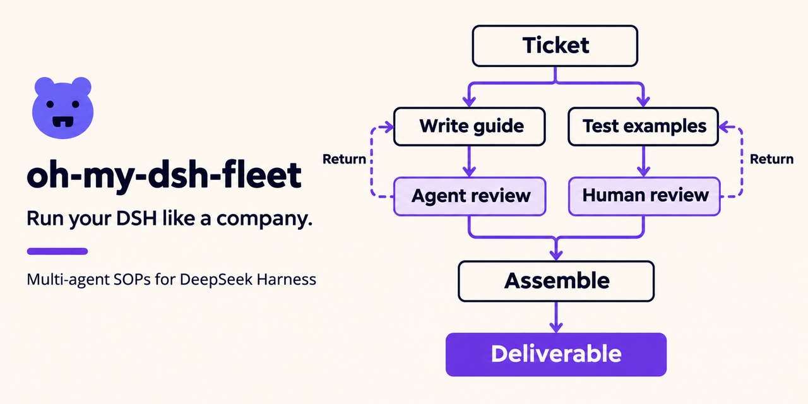
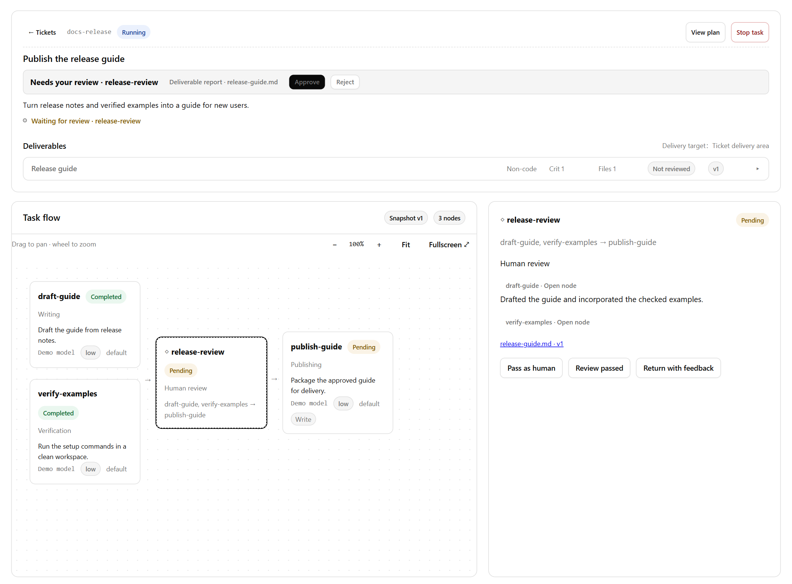
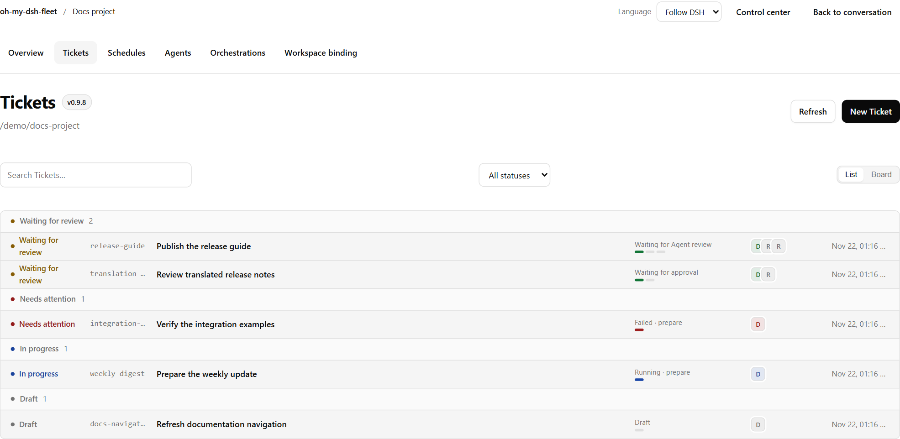
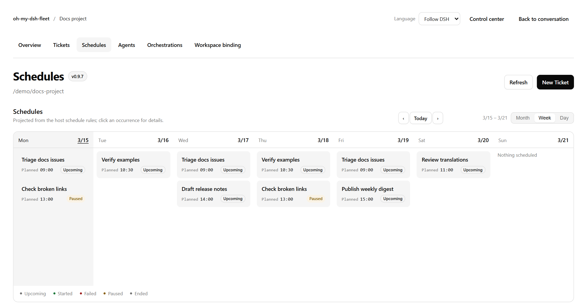
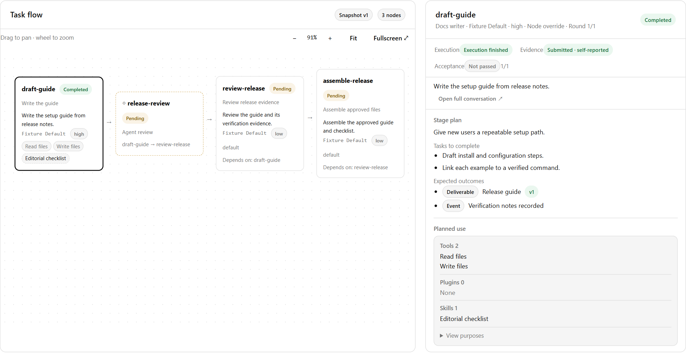
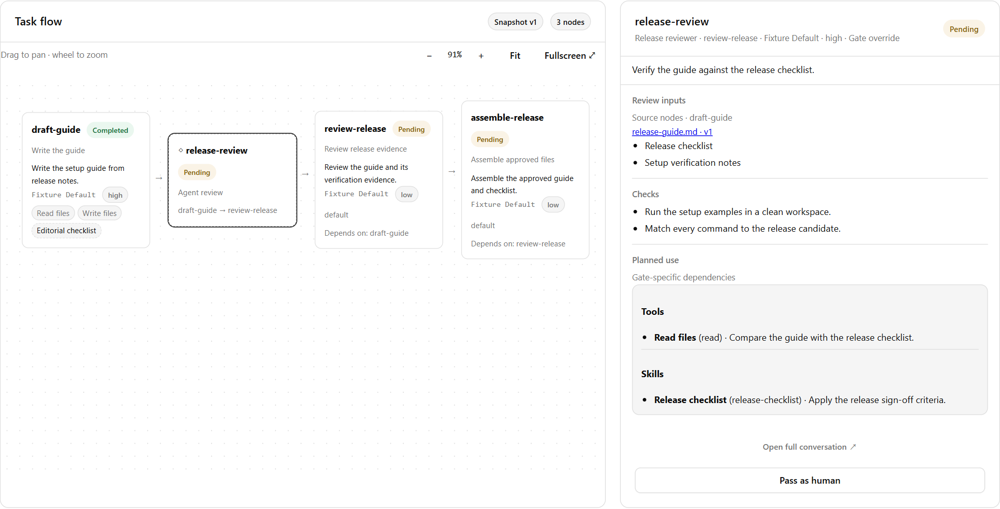

<p align="right"><strong>English</strong> · <a href="README_ZH.md">简体中文</a></p>

#  oh-my-dsh-fleet

**Run your DSH like a company.**

Run operations from a project folder. Use the Workspace to see everything in flight and a Ticket to take each job through delivery. Define who owns each stage, what they hand off, and where reviews happen.

`oh-my-dsh-fleet` is a DeepSeek Harness (DSH) plugin for multi-agent workflow orchestration. It turns a chat request into a Ticket with a runnable standard operating procedure (SOP). Review the plan before starting, then follow each stage in its native DSH session. Save a workflow that works as a template for the next run.



**Compatibility** · Fleet `0.9.8` · DeepSeek Harness `0.2.2-rc.5` · [Download the plugin](https://github.com/ohmyskyhigh/oh-my-dsh-fleet/releases/download/v0.9.8/dsh-fleet-shell-0.9.8.tgz)



*A release SOP in action. Two agents have drafted the guide and verified the setup examples. The final delivery step waits for you to review `release-guide.md`.*

[Workspace operations](#run-each-workspace-as-an-operating-unit) · [Ticket lifecycle](#take-each-ticket-from-request-to-delivery) · [Agent execution](#plan-and-inspect-every-stage) · [Review and rework](#set-up-approval-gates) · [Quick start](#quick-start) · [Install and compatibility](#install-and-compatibility)

## Install and compatibility

Fleet **`0.9.8`** ships as `@dsh-fleet/shell`. Its manifest requires **[DeepSeek Harness](https://github.com/deepseek-ai/deepseek-harness) `0.2.2-rc.5`**. If you use the CLI, run `dsh --version` to check your host version.

### DeepSeek Harness Desktop

1. Download [`dsh-fleet-shell-0.9.8.tgz`](https://github.com/ohmyskyhigh/oh-my-dsh-fleet/releases/download/v0.9.8/dsh-fleet-shell-0.9.8.tgz) from [Release v0.9.8](https://github.com/ohmyskyhigh/oh-my-dsh-fleet/releases/tag/v0.9.8). Keep the archive compressed.
2. In DSH, open **Plugins → Add plugin** and enter the absolute path to the downloaded archive. Enable `oh-my-dsh-fleet` after installation and restart if prompted.
3. Enable Fleet for your workspace from the Fleet sidebar. Open a native chat in that workspace and send `/fleet help` to verify that the commands are available.

### CLI-managed DSH profiles

Replace `web` with your active profile name and use the absolute path to the downloaded archive.

```sh
dsh plugin --profile web add "/path/to/dsh-fleet-shell-0.9.8.tgz" --ignore-scripts
```

Open or restart that profile, enable Fleet for your workspace from the sidebar, and send `/fleet help` in a workspace chat.

### Build from source

With Node.js 22.15 or later and pnpm, run these commands from the repository root. Install the resulting `.tgz` using the Desktop or CLI instructions above.

```sh
pnpm install --frozen-lockfile
pnpm build
pnpm check:package
pnpm --dir packages/fleet-shell pack
```

## Quick start

Enable `oh-my-dsh-fleet` for a workspace from the Fleet sidebar. Open a native DSH chat in that workspace and describe the job. Fleet drafts it as an SOP:

```text
/fleet new Prepare a release guide for new users. Have one agent draft it from the release notes and another verify the setup examples. Ask me to review the draft and verification results before finalizing release-guide.md.
```

1. **Review the SOP.** Open the conversation’s **Fleet** tab: deliverables, acceptance criteria, agent roles, dependencies, and review gates. Adjust it with your agent or edit it in Fleet.
2. **Start the run.** Click **Start** when the plan is ready. Fleet freezes the execution plan and dispatches nodes as their dependencies clear.
3. **Review and collect the work.** Open a node’s DSH conversation to see its progress. Review the submitted files at the gate and check the Ticket’s deliverables for the final file and verification evidence.

## Run each Workspace as an operating unit

**Register a project folder as a DSH Workspace and build an operating routine around its files.** A documentation workspace, for example, can handle a release guide, setup verification, and recurring maintenance. The project files and the Dashboard for its active work, pending approvals, and delivery records all belong to the same workspace.

- **Daily operations.** Use the Workspace Dashboard to see which Tickets are running, waiting for a decision, need attention, or have been delivered. The Fleet overview also lets you find work and schedules across workspaces and open the owning workspace.
- **Internal controls.** Define the SOP in each Ticket. Agree up front on the required deliverables, where reviews happen, and what evidence you will accept. Start from Fleet’s shared agent and workflow templates and adapt the plan to the project.
- **Recurring work.** Use DSH’s scheduler to run a template or an existing Ticket once or on a recurring schedule. Each occurrence gets its own Ticket, review record, and deliverables. The calendar has month, week, and day views.



*The Workspace Dashboard puts multiple Tickets in one view so you can see what is moving and what needs attention.*

<details>
<summary>See one-time and recurring work on the weekly calendar</summary>



</details>

## Take each Ticket from request to delivery

**A Ticket is a unit of work you can track independently.** It holds the goal, inputs, acceptance criteria, agent assignments, dependencies, and reviews. Multiple Tickets can run in one Workspace. Fleet dispatches nodes as their dependencies and available execution slots allow, so eligible work can move forward while another Ticket waits for human review.

1. **Draft and start.** Send `/fleet new` in DSH chat. Check the deliverables, assignments, and gates, then start. Fleet freezes the plan for that run.
2. **Track progress and recover.** Independent nodes can run in parallel. The Dashboard shows work that failed or is waiting for verification or review. Open the relevant session, retry a node, or stop and revise unfinished work before resuming the same Ticket.
3. **Deliver and verify.** Submitted files are versioned. A submission can include acceptance results and verification evidence. For a Ticket with declared file deliverables, Fleet checks the nodes, gates, and required deliverables before marking it delivered. Explicit human overrides are recorded.

## Plan and inspect every stage

**Separate session context.** Each node attempt starts its own native DSH session with the stage task, declared inputs, and results from its upstream dependencies. Downstream agents pick up the work from summaries, handoff notes, and artifact locations. Conversation histories stay separate, while agents can access the shared Workspace files.

**Choose a model for the work.** Execution nodes and agent review gates can use different models and available reasoning settings from the DSH catalog. For example, routine preparation and a review that needs deeper analysis can use different models. The graph and node details show the effective configuration.

**See what each agent is supposed to do.** Refine the stages in the planning chat, then inspect the task summary, dependencies, and stage plan in the Ticket. Each stage can record a goal, tasks, and expected outcomes. An outcome linked to a Ticket deliverable shows its submission status or version. Node details also list the planned **skills, tools, and plugins** and their intended uses. Open the attempt’s native session to see how it actually ran.



*Open a node to check its assigned task, expected outcomes, and the capabilities it plans to use.*

## Set up approval gates

A review gate defines which outputs to inspect, who reviews them, and which downstream work waits for approval. A single Ticket can use different review types on different branches.

| Review | How it works |
| --- | --- |
| **Agent review** | The reviewer agent checks designated inputs against its checklist in a separate session. It can use its own model, skills, and tools. |
| **Human review** | The person responsible opens the materials and versions in the Ticket, then approves them or returns them with feedback. |
| **Rework and re-review** | Downstream work stays blocked. With rework enabled, the designated upstream nodes rerun with the reviewer’s feedback and submit their new results for review. Automatic rework from agent review follows the configured round limit. You can also retry manually. |



*This reviewer is set up to inspect version 1 of `release-guide.md` and run the setup examples in a clean workspace. If a command differs from the release candidate, the reviewer can send it back with that finding. The release guide screenshot above shows the equivalent human review controls.*

Product screenshots show the actual Fleet interface with isolated demo data.

## Documentation

- [Fleet user reference](docs/usage.md) covers Tickets, approval gates, schedules, and recovery.
- [Plugin package notes](packages/fleet-shell/README.md) cover compatibility and first use.

## Development checks

After installing dependencies, run `pnpm test` for the unit and integration fixtures. For the optional browser fixture, first run `pnpm exec playwright-core install chromium` and then `pnpm test:browser`. Set `FLEET_TEST_BROWSER` to an existing Chromium executable to use that browser instead.

## License

Available under the [MIT License](LICENSE). See the [third-party notices](packages/fleet-shell/THIRD-PARTY-NOTICES.txt) for attribution.
