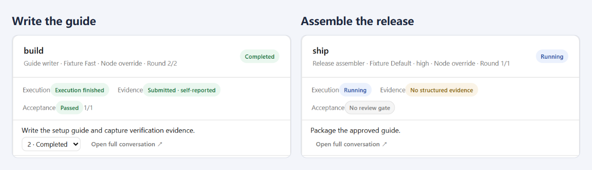
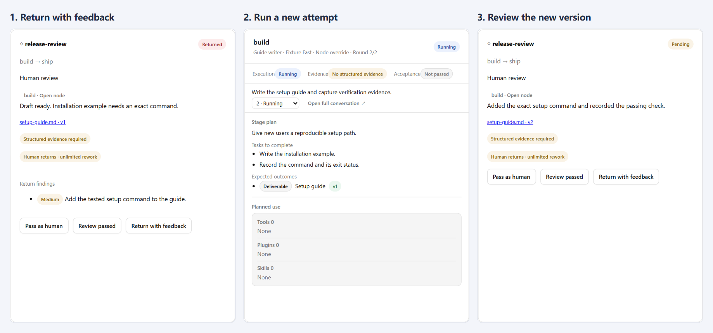
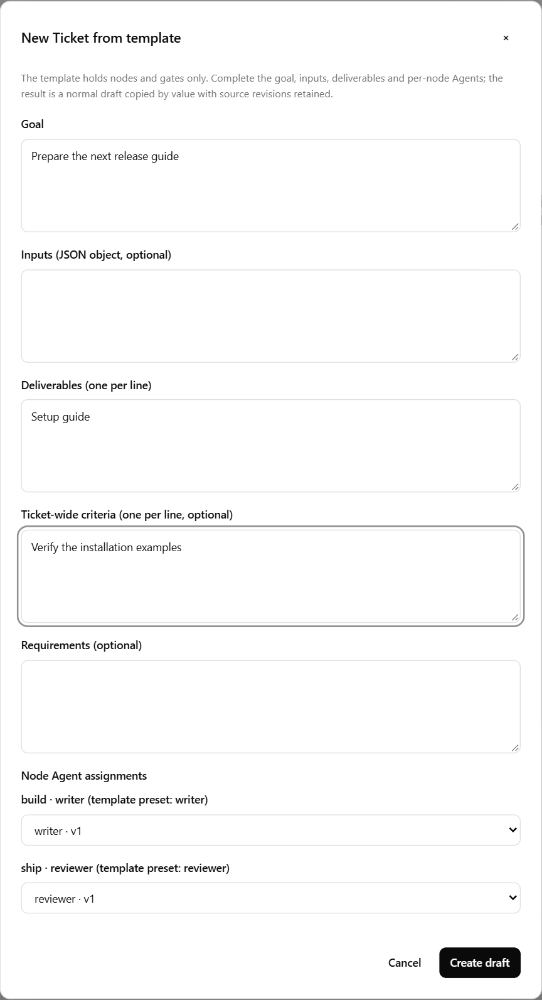

<p align="right"><strong>English</strong> · <a href="README_ZH.md">简体中文</a></p>

#  oh-my-dsh-fleet

**Run DSH like a company.**

oh-my-dsh-fleet is a multi-agent workflow plugin for DeepSeek Harness (DSH). Run operations from a project folder. Use a Ticket to define an SOP, assign each stage, specify what gets handed off, and decide where work needs review before delivery.


[Install](#install-and-compatibility) · [Feature tour](#feature-tour) · [First Ticket](#run-your-first-ticket) · [Commands](#common-commands) · [Development](#development)

## Install and compatibility

| Plugin | DeepSeek Harness | Check the host version |
| --- | --- | --- |
| `oh-my-dsh-fleet@0.12.0` | **`0.2.2-rc.5`** | Run `dsh --version` for the CLI. Desktop uses its bundled Harness. |

| Source | Desktop · Plugins → Add plugin | CLI · Replace `web` with your Profile |
| --- | --- | --- |
| **GitHub Release** | Download [`oh-my-dsh-fleet-0.12.0.tgz`](https://github.com/ohmyskyhigh/oh-my-dsh-fleet/releases/download/v0.12.0/oh-my-dsh-fleet-0.12.0.tgz) and enter its absolute path. | `dsh plugin --profile web add "/path/to/oh-my-dsh-fleet-0.12.0.tgz" --ignore-scripts` |
| **GitHub repository** | Paste `https://github.com/ohmyskyhigh/oh-my-dsh-fleet` to install the default branch. | `dsh plugin --profile web add github:ohmyskyhigh/oh-my-dsh-fleet --ignore-scripts` |
| **[npm](https://www.npmjs.com/package/oh-my-dsh-fleet/v/0.12.0)** | Enter `oh-my-dsh-fleet@0.12.0`. | `dsh plugin --profile web add --save-exact oh-my-dsh-fleet@0.12.0` |

Enable the plugin after installing and restart the app or CLI Profile if prompted. Open **oh-my-dsh-fleet** from the sidebar, enable Fleet for the target Workspace, and send `/fleet help` in a chat within that Workspace.

### Upgrade from 0.9.8

The previous package was `@dsh-fleet/shell`. Wait for active work to stop before replacing it with `oh-my-dsh-fleet`. Use the desktop plugin manager, or stop the CLI Profile, run these commands, and restart the same Profile.

```sh
dsh plugin --profile web remove @dsh-fleet/shell
dsh plugin --profile web add "/path/to/oh-my-dsh-fleet-0.12.0.tgz" --ignore-scripts
```

Use the same Workspace folders and Fleet data location. Existing Tickets, templates, schedules, and `/fleet` commands carry over. [Previous release](https://github.com/ohmyskyhigh/oh-my-dsh-fleet/releases/tag/v0.9.8)

## Feature tour

The screenshots show the actual Fleet interface with isolated demo data. Click an image to open it at full size.

| Feature and where to find it | Screenshot |
| --- | --- |
| **Run a Workspace as an operating unit**<br>Open the Workspace **Tickets** list. A Ticket can wait for human approval while other work moves forward as dependencies and available execution slots allow. |  |
| **Take one Ticket from SOP to delivery**<br>Check dependencies, attempts, and outputs in the Ticket. Submitted files retain versions, and the delivery area records the final files and evidence. |  |
| **Separate sessions and models by node**<br>Each attempt has its own native DSH session and can receive handoff notes and artifacts from previous stages. The Workspace files are shared. Choose models and available reasoning settings for stages and agent reviews separately. |  |
| **Inspect every stage**<br>Open a node to see the task summary, stage goal, expected deliverables, and planned skills, tools, and plugins. Open the native session to see the actual execution. |  |
| **Return work, rerun, and review again**<br>A return holds downstream work. When rework is configured, designated upstream nodes start a new attempt with feedback and can submit the new version for another review. Automatic rework from agent review follows the configured round limit. |  |

### Agent and human review

Set different review gates on different branches of the same Ticket. Reviews refer to versioned materials, and downstream work waits for the relevant gates and dependencies.

| Agent review | Human review |
| --- | --- |
| Give a reviewer specific inputs and checks, plus its own model, skills, and tools. | Open the review materials to approve the work or return it with feedback. |
|  |  |

### Ticket dependencies and Logic Gates

In **Edit draft → Upstream dependencies and conditional routes**, select upstream Tickets for the entire Ticket or for individual steps in the same Workspace. Save the draft, then choose **Enable start after upstream delivery** if you want the whole Ticket to start automatically. Step dependencies let independent work proceed while a step waits. For recurring work, match upstream series per occurrence or choose **Follow upstream series** to run when a selected upstream series produces an occurrence.

Use **Add logic gate** to route work based on structured handoff fields from an earlier step. Every matching route runs. You can make a deliverable required only when its producing step runs. See the [Fleet user reference](docs/usage.md#coordinate-tickets-and-route-work) for the setup steps.

### Templates and recurring operations

In the chat where you created a Ticket, ask “Schedule this Ticket every Monday at 09:00 Asia/Shanghai.” Fleet creates the schedule in the background and returns its series ID and next run. You can also request a single run on a specific date or a daily run.

| Reuse an SOP | Schedule a run |
| --- | --- |
| Create a Ticket from a workflow template. Reuse the dependencies and gates, then set the goal, deliverables, and agent assignments for this run. | Use DSH’s scheduler for one-time or recurring runs. Each occurrence has its own Ticket, review, and delivery record. |
|  |  |

## Run your first Ticket

Send this in a chat within a Workspace with Fleet enabled:

```text
/fleet new Write a release guide for new users. Have one agent draft the guide from the release notes and another verify the existing setup examples. Ask me to review the draft and test results before assembling release-guide.md for delivery.
```

| Step | What to do |
| --- | --- |
| **Review the SOP** | Open the conversation’s Fleet tab and check deliverables, acceptance criteria, dependencies, and gates. |
| **Start the run** | Click **Start**. Fleet freezes the plan and dispatches nodes as dependencies clear and execution slots become available. |
| **Review and collect** | Open the submitted files to approve or return them. When the workflow finishes, check the final files and evidence in the delivery area. |

## Common commands

| Command | What it does |
| --- | --- |
| `/fleet help` | Show commands and the plan format. |
| `/fleet new <request>` | Draft a Ticket from the current Workspace chat. |
| `/fleet list` · `/fleet show <Ticket>` | View Tickets, detailed status, and execution history. |
| `/fleet thread <Ticket> <node>` | Find the node and its native session. |
| `/fleet deliverables <Ticket>` | Inspect deliverables, versions, and review records. |

See the [Fleet user reference](docs/usage.md) for more operations.

## Development

Use Node.js 22.15 or later and pnpm. From the repository root, run:

```sh
pnpm install --frozen-lockfile
pnpm build
pnpm check:package
pnpm test
pnpm pack
```

For the optional browser checks, run `pnpm exec playwright-core install chromium` and then `pnpm test:browser`. Set `FLEET_TEST_BROWSER` to use an existing Chromium executable.

## License

[MIT](LICENSE) · [Third-party notices](THIRD-PARTY-NOTICES.txt)
