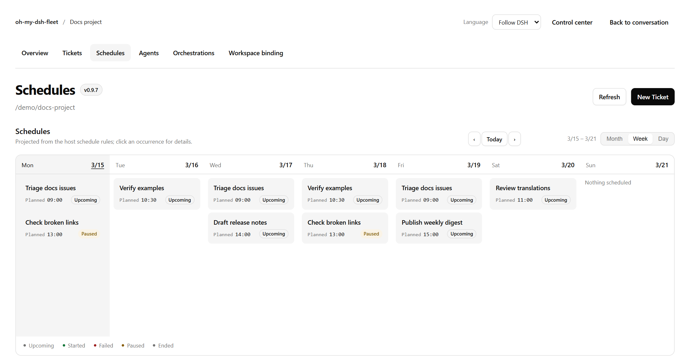
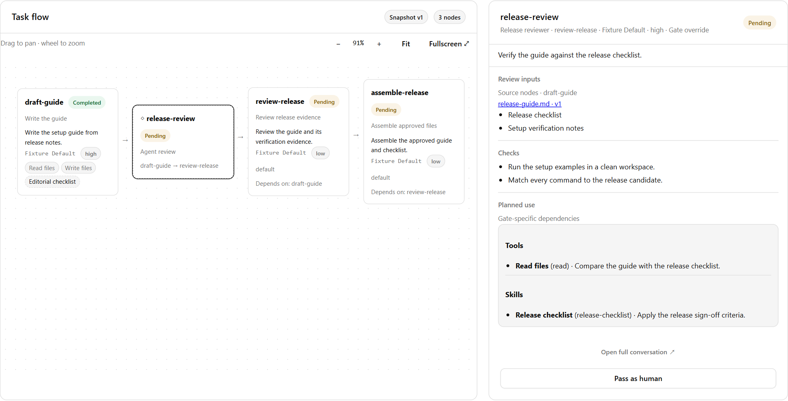

<p align="right"><a href="README.md">English</a> · <strong>简体中文</strong></p>

#  oh-my-dsh-fleet

**把 DSH 当成一家公司来经营。**

一个项目文件夹，一套运营体系。用 Workspace 管日常，用 Ticket 推进每一项工作。每个阶段谁负责、交接什么、哪里需要你审核，都写进 SOP。

`oh-my-dsh-fleet` 是 DeepSeek Harness（DSH）的多 Agent 工作流编排插件。它把对话里的需求整理成一张 Ticket，按其中的 SOP（标准作业流程）执行。启动前确认计划，执行中从节点打开 DSH 原生对话看进度。跑顺的流程可以存成模板，下次接着用。


**兼容版本**　Fleet `0.9.8` · DeepSeek Harness `0.2.2-rc.5` · [下载安装包](https://github.com/ohmyskyhigh/oh-my-dsh-fleet/releases/download/v0.9.8/dsh-fleet-shell-0.9.8.tgz)


*这是一次发布 SOP 的执行现场。两位 Agent 已分别完成指南撰写和安装示例验证。你审核 `release-guide.md` 后，最终交付步骤才会继续。*

[Workspace 运营](#一个-workspace-一套运营体系) · [Ticket 执行](#一张-ticket-从需求推进到交付) · [Agent 分工与观察](#按阶段分工按节点查看) · [OA 审核](#在关键交接处设置-oa-审核) · [快速上手](#快速上手) · [安装与兼容性](#安装与兼容性)

## 安装与兼容性

Fleet **`0.9.8`** 的插件包名为 `@dsh-fleet/shell`，清单要求 **[DeepSeek Harness](https://github.com/deepseek-ai/deepseek-harness) `0.2.2-rc.5`**。有 CLI 时可运行 `dsh --version` 核对宿主版本。

### DeepSeek Harness 桌面端

1. 从 [v0.9.8 Release](https://github.com/ohmyskyhigh/oh-my-dsh-fleet/releases/tag/v0.9.8) 下载 [`dsh-fleet-shell-0.9.8.tgz`](https://github.com/ohmyskyhigh/oh-my-dsh-fleet/releases/download/v0.9.8/dsh-fleet-shell-0.9.8.tgz)，保留压缩包。
2. 在 DSH 打开「插件 → 添加插件」，输入下载包的本机绝对路径。安装后启用 `oh-my-dsh-fleet`，如果界面提示重启，按提示重启。
3. 在 Fleet 侧栏为目标工作区启用 Fleet。进入该工作区的原生对话，发送 `/fleet help` 验证入口可用。

### CLI 管理的 DSH Profile

把 `web` 换成你实际使用的 Profile 名，把路径换成安装包的本机绝对路径。

```sh
dsh plugin --profile web add "/path/to/dsh-fleet-shell-0.9.8.tgz" --ignore-scripts
```

打开或重启该 Profile，然后在侧栏启用工作区的 Fleet，再在工作区对话中发送 `/fleet help`。

### 从源码构建

准备 Node.js 22.15 或更高版本以及 pnpm，在仓库根目录执行下面的命令。打包后按上面的桌面端或 CLI 步骤安装生成的 `.tgz`。

```sh
pnpm install --frozen-lockfile
pnpm build
pnpm check:package
pnpm --dir packages/fleet-shell pack
```

## 快速上手

从 DSH 侧栏的 Fleet 入口为一个工作区启用 `oh-my-dsh-fleet`。在这个工作区打开原生对话，把要做的活写下来。Fleet 会把它整理成一份 SOP：

```text
/fleet new 为新用户准备一份发布指南。安排一位 Agent 根据发布说明撰写初稿，另一位验证安装示例。交付 release-guide.md 前，请我审核初稿和验证结果。
```

1. **核对这份 SOP。** 打开会话的 **Fleet** 标签页，检查交付文件、验收标准、Agent 岗位、依赖与审核关卡。可以在对话中请 Agent 调整，也可以在 Fleet 中直接编辑。
2. **启动执行。** 计划准备好后点击「启动」。Fleet 会冻结本轮执行计划，并在依赖满足后派发节点。
3. **审核并验收。** 从节点打开原生对话查看进展，在关卡里审核已提交的材料，最后到 Ticket 的交付物区域查阅文件和验证依据。

## 一个 Workspace 一套运营体系

**把一个项目文件夹登记为 DSH Workspace，就能围绕其中的资料、代码和产物建立一套运营方式。** 例如，一个文档工作区可以同时运行发布指南、安装示例验证和定期文档巡检。项目文件在工作区内，各项工作的进度、待审核事项和交付记录也可以从同一个工作区 Dashboard 找到。

- **日常运营**从概览或 Ticket 列表查看进行中、等待决定、需要处理和已交付的任务。Fleet 总览也可以跨工作区查看待办与计划，再回到所属工作区处理。
- **内控流程**通过 Ticket 里的 SOP 定义。哪些工作要有明确交付物，哪一步需要审核，哪些材料可以作为验收依据，都在启动前约定。可从 Fleet 的共享 Agent 模板和编排模板创建 Ticket，再按本项目调整。
- **运营节奏**可以交给 DSH 的定时服务。从模板或现有 Ticket 安排一次性或重复任务，每期拥有自己的 Ticket、审核记录和交付结果。日历支持月、周、日视图。


*工作区 Dashboard 将多张 Ticket 放在一起，方便看出哪些工作正在推进、哪些需要负责人处理。*

<details>
<summary>看一次性与周期任务如何出现在周历上</summary>



</details>

## 一张 Ticket 从需求推进到交付

**Ticket 是独立推进的工作单。** 它把目标、输入、验收标准、Agent 分工、依赖和审核写进同一份计划。一个 Workspace 可以同时有多张 Ticket 在运行。Fleet 根据依赖和可用并发额度派发节点，所以一张 Ticket 等人工审核时，其他具备条件的工作仍可推进。

1. **建单和启动。** 在 DSH 对话里用 `/fleet new` 提需求，确认草稿中的交付物、责任与审核点后启动。Fleet 冻结本次执行计划。
2. **推进和恢复。** 独立节点可以并行。遇到失败、待核对或待审核的节点，Dashboard 会显示相应状态。你可以打开执行会话、重试相关节点，或停止后修改未完成部分并恢复同一张 Ticket。
3. **交付和查证。** 节点提交的文件带版本，验收结果和验证记录可以随提交保留。对于声明了文件交付物的 Ticket，Fleet 会检查节点、关卡和交付物是否满足结算条件。需要人工例外放行时，操作会记入记录。

## 按阶段分工按节点查看

**独立的会话上下文。** 节点每次执行都会创建自己的原生 DSH 会话，并带上该阶段的任务、约定的输入和所依赖的上游结果。下游 Agent 通过摘要、交接说明和产物位置接手。会话历史各自独立，项目文件由同一个 Workspace 共享。

**按工作选模型。** 执行节点和 Agent 审核关卡可分别选择 DSH 模型目录中的模型与可用推理强度。例如，常规整理与需要深入检查的审核可以使用不同模型。你可以在流程图和节点详情查看有效配置。

**从 Ticket 看清每一步。** 在规划对话里调整阶段内容，再打开 Ticket 核对节点的任务摘要、依赖和阶段计划。阶段计划说明目标、具体任务和预期结果。关联 Ticket 交付物时，可以看到待提交或具体版本。节点详情还列出计划使用的 **Skills、Tools 和插件**，以及用途。要追查实际执行过程，可以打开对应轮次的原生会话。


*点开一个节点，可以核对这个阶段的任务、预期结果，以及执行时计划使用的能力。*

## 在关键交接处设置 OA 审核

Fleet 的 OA 审核关卡定义了哪个阶段的结果要审、由谁审，以及审核通过后才能继续的工作。你可以在同一张 Ticket 里设置两种关卡，让不同支线采用适合自己的审核方式。

| 审核方式 | 如何推进 |
| --- | --- |
| **Agent 审核** | 到达关卡后，审核 Agent 在独立会话里根据指定的输入和检查项审核。可以为它单独配置模型、Skills 和 Tools。 |
| **人工审核** | 到达关卡后，负责人在 Ticket 里查看待审材料及其版本，决定放行或带着意见退回。 |
| **退回与重审** | 下游继续等待。启用返工策略时，指定的上游节点带着退回意见进入新一轮执行，再把结果提交审核。Agent 审核触发的自动返工受配置的轮数限制。你也可以手动重试。 |



*图中审核 Agent 要检查 `release-guide.md` 的第 1 版，并在干净的工作区重跑安装示例。如果发现某条命令与发布候选版本不符，它可以附上问题退回。页首的发布指南截图展示了人工放行或退回的操作。*

以上产品截图均使用真实 Fleet 界面与隔离演示数据。

## 项目文档

- [Fleet 用户参考（英文）](docs/usage.md) 介绍 Ticket、审核关卡、计划和执行恢复。
- [插件包说明（英文）](packages/fleet-shell/README.md) 包含兼容性和上手步骤。

## 开发验证

安装依赖后，运行 `pnpm test` 执行单元测试与集成测试。若要运行可选的浏览器测试，先执行 `pnpm exec playwright-core install chromium`，再执行 `pnpm test:browser`。如已安装 Chromium，可用 `FLEET_TEST_BROWSER` 指定可执行文件。

## 许可证

项目采用 [MIT 许可证](LICENSE)。相关归属见[第三方声明](packages/fleet-shell/THIRD-PARTY-NOTICES.txt)。
