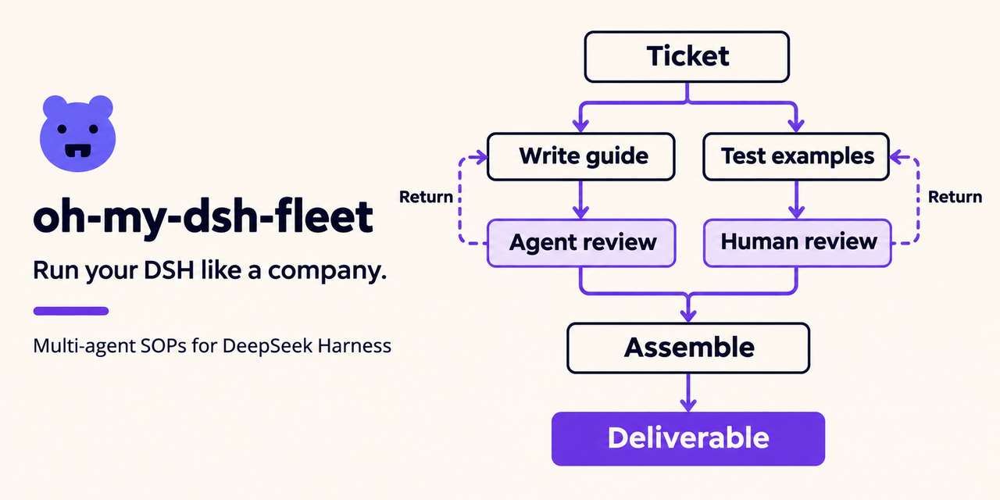
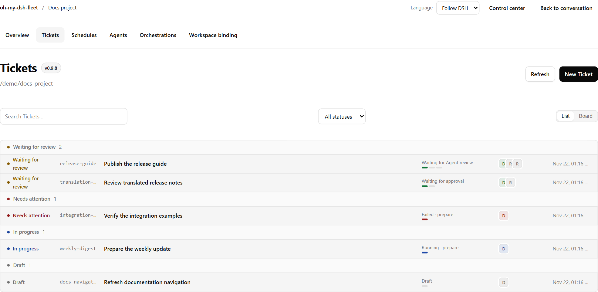
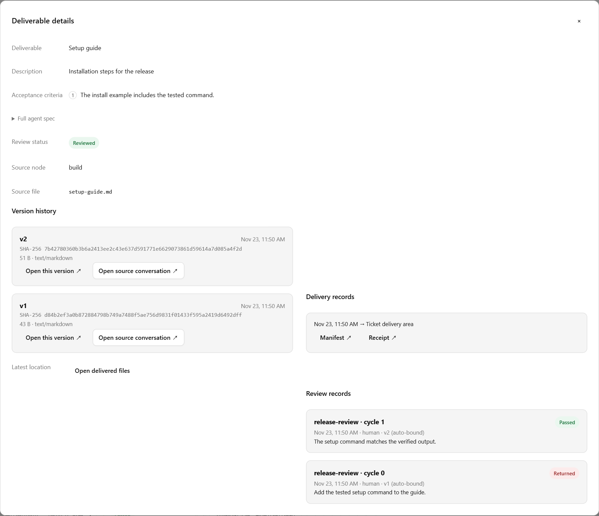
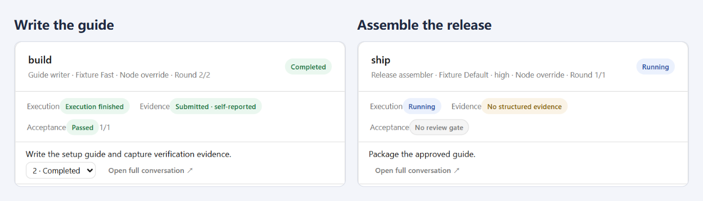
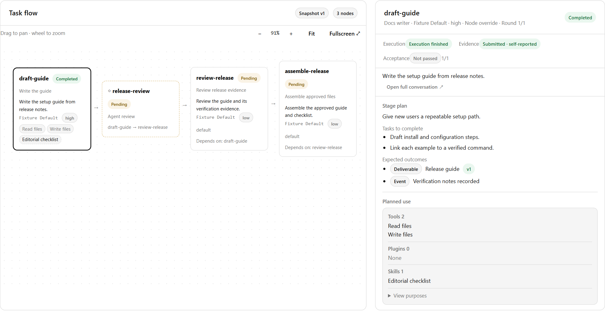
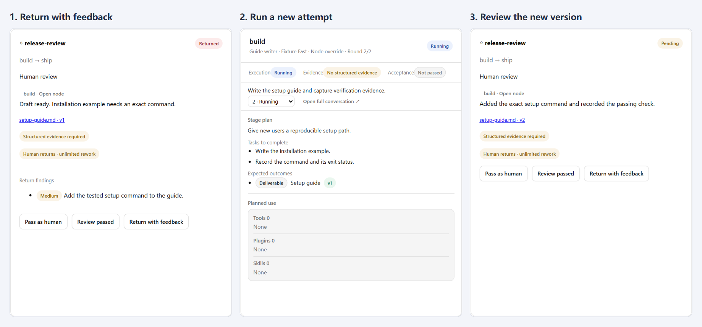
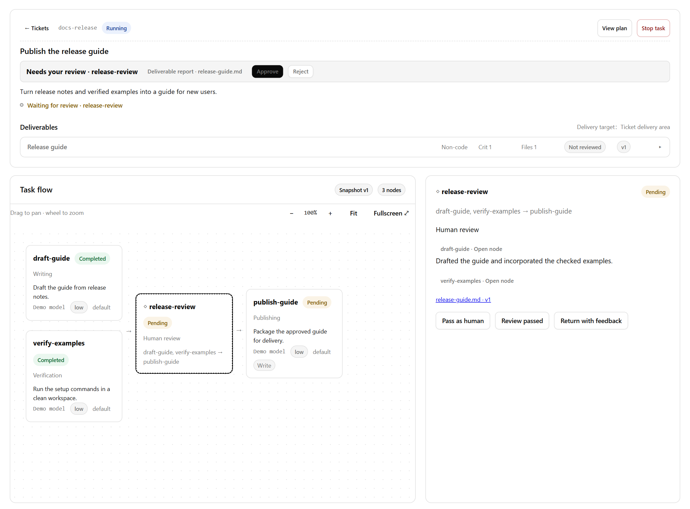
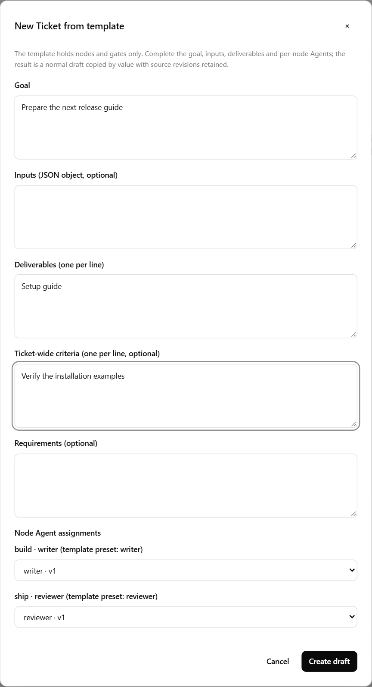

<p align="right"><a href="README.md">English</a> · <strong>简体中文</strong></p>

#  oh-my-dsh-fleet

**把 DSH 当成一家公司来经营。**

oh-my-dsh-fleet 是 DeepSeek Harness（DSH）的多 Agent 工作流插件。一个项目文件夹就是一个运营 Workspace。用 Ticket 定义团队 SOP，安排谁做哪一步、交接什么、哪里需要审核，再追踪到最终交付。



[安装与兼容性](#安装与兼容性) · [功能图鉴](#功能图鉴) · [第一张 Ticket](#跑第一张-ticket) · [常用命令](#常用命令) · [开发](#开发)

## 安装与兼容性

| 插件 | DeepSeek Harness | 确认版本 |
| --- | --- | --- |
| `oh-my-dsh-fleet@0.10.0` | **`0.2.2-rc.5`** | CLI 执行 `dsh --version`。桌面端使用应用自带的 Harness。 |

| 安装渠道 | 桌面端「插件 → 添加插件」 | CLI（将 `web` 换成你的 Profile） |
| --- | --- | --- |
| **GitHub Release** | 下载 [`oh-my-dsh-fleet-0.10.0.tgz`](https://github.com/ohmyskyhigh/oh-my-dsh-fleet/releases/download/v0.10.0/oh-my-dsh-fleet-0.10.0.tgz)，输入压缩包的绝对路径。 | `dsh plugin --profile web add "/path/to/oh-my-dsh-fleet-0.10.0.tgz" --ignore-scripts` |
| **GitHub 仓库** | 粘贴 `https://github.com/ohmyskyhigh/oh-my-dsh-fleet`，从默认分支安装。 | `dsh plugin --profile web add github:ohmyskyhigh/oh-my-dsh-fleet --ignore-scripts` |
| **[npm](https://www.npmjs.com/package/oh-my-dsh-fleet/v/0.10.0)** | 输入 `oh-my-dsh-fleet@0.10.0`。 | `dsh plugin --profile web add --save-exact oh-my-dsh-fleet@0.10.0` |

安装后启用插件，按提示重启桌面应用或 CLI Profile。在侧栏打开 **oh-my-dsh-fleet**，为目标 Workspace 开启 Fleet，然后在该 Workspace 的对话中发送 `/fleet help`。

### 从 0.9.8 升级

旧版安装包名为 `@dsh-fleet/shell`。先让执行中的工作停下来，再移除旧包并安装 `oh-my-dsh-fleet`。在桌面端通过插件管理器完成替换。CLI 用户先停止目标 Profile，运行以下命令，再启动同一个 Profile。

```sh
dsh plugin --profile web remove @dsh-fleet/shell
dsh plugin --profile web add "/path/to/oh-my-dsh-fleet-0.10.0.tgz" --ignore-scripts
```

使用原来的 Workspace 文件夹与 Fleet 数据位置。已有 Ticket、模板、计划和 `/fleet` 命令继续使用。 [旧版 0.9.8 下载](https://github.com/ohmyskyhigh/oh-my-dsh-fleet/releases/tag/v0.9.8)

## 功能图鉴

产品截图使用真实 Fleet 界面与隔离演示数据。点图可看原尺寸。

| 功能与操作入口 | 界面截图 |
| --- | --- |
| **一个 Workspace，一套运营体系**<br>在 Workspace 的 **Tickets** 列表查看多张 Ticket。等人工审批的 Ticket 可以留在原地，其他满足依赖、且有可用执行额度的任务继续推进。 |  |
| **同一张 Ticket，从 SOP 到交付**<br>在 Ticket 详情查看依赖、运行轮次和可验收的产出。提交的文件留有版本，最终交付区域可以核对文件和相关记录。 |  |
| **独立会话，按节点选模型**<br>每个执行轮次使用独立 DSH 会话，通过摘要和产物交接，并可使用 Workspace 共享文件。可给执行节点和 Agent 审核关卡分别选择模型与可用推理强度。 |  |
| **每一步可观测**<br>点开节点，查看任务摘要、阶段目标、预期交付物，以及计划使用的 Skills、Tools 和插件。通过执行轮次打开原生会话，可以追查实际执行。 |  |
| **退回、返工与复审**<br>审核退回后，下游等待。启用返工策略时，指定节点收到意见并开启新轮次，新版本提交后可重新审核。Agent 自动返工遵循配置的轮数上限。 |  |

### Agent 与人工审核

一张 Ticket 可以在不同支线设置不同关卡。审核材料带有版本，只有满足关卡与依赖要求的下游步骤才会继续。

| Agent 审核 | 人工审核 |
| --- | --- |
| 审核 Agent 根据指定输入和检查项做判断，可单独选模型、Skills 和 Tools。 | 负责人打开待审材料，批准或附意见退回。 |
|  |  |

### 模板与定时运营

| 模板复用 | 定时执行 |
| --- | --- |
| 从编排模板创建 Ticket，复用依赖和审核方式，再填写本次目标、交付物和 Agent 分工。 | 用 DSH 定时服务安排一次或重复执行。每一期有独立的 Ticket、审核和交付记录。 |
|  |  |

## 跑第一张 Ticket

在已启用 Fleet 的 Workspace 对话中发送：

```text
/fleet new 为新用户写一份发布指南。让一位 Agent 根据发布说明起草，另一位核对现有安装示例。汇总前请我审核初稿与验证结果，最终交付 release-guide.md。
```

| 阶段 | 操作 |
| --- | --- |
| **核对 SOP** | 在会话的 Fleet 标签页检查交付文件、验收标准、依赖和审核关卡。 |
| **启动执行** | 点击「启动」。Fleet 冻结计划，按依赖和可用额度派发节点。 |
| **审核与收取** | 打开待审文件，批准或退回。流程完成后，在交付物区域核对最终文件和证据。 |

## 常用命令

| 命令 | 用途 |
| --- | --- |
| `/fleet help` | 查看命令和计划格式。 |
| `/fleet new <需求>` | 从当前 Workspace 对话建单。 |
| `/fleet list` · `/fleet show <Ticket>` | 查看 Ticket 列表、详细状态和执行记录。 |
| `/fleet thread <Ticket> <节点>` | 找到节点及其原生会话。 |
| `/fleet deliverables <Ticket>` | 查看交付物、版本及审核记录。 |

更多操作见 [Fleet 用户参考（英文）](docs/usage.md)。

## 开发

使用 Node.js 22.15 或更高版本及 pnpm，在仓库根目录执行：

```sh
pnpm install --frozen-lockfile
pnpm build
pnpm check:package
pnpm test
pnpm pack
```

可选浏览器检查先执行 `pnpm exec playwright-core install chromium`，再执行 `pnpm test:browser`。也可用 `FLEET_TEST_BROWSER` 指定已有 Chromium。

## 许可证

[MIT](LICENSE) · [第三方声明](THIRD-PARTY-NOTICES.txt)
